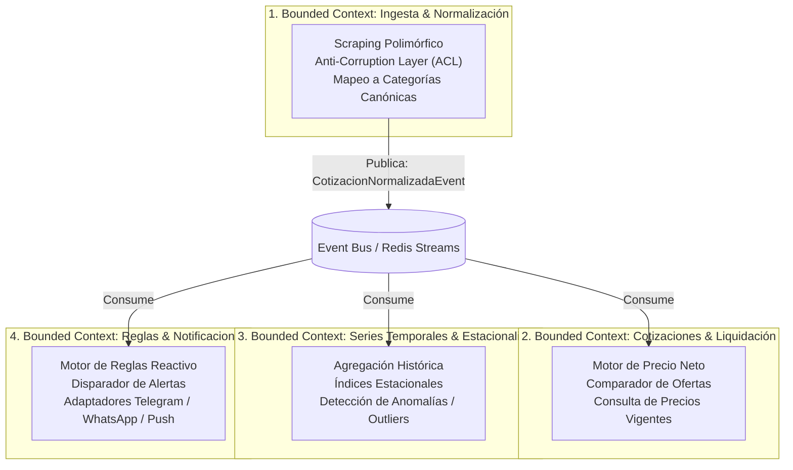
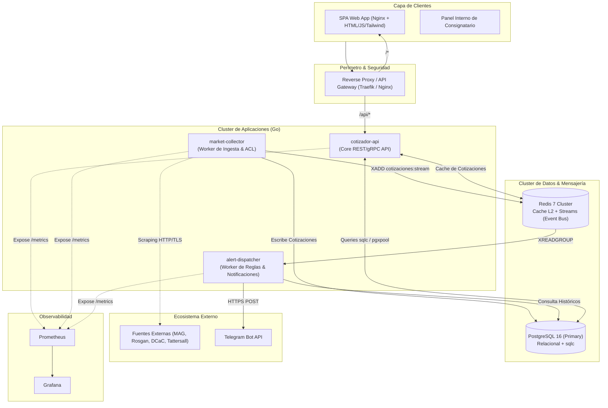
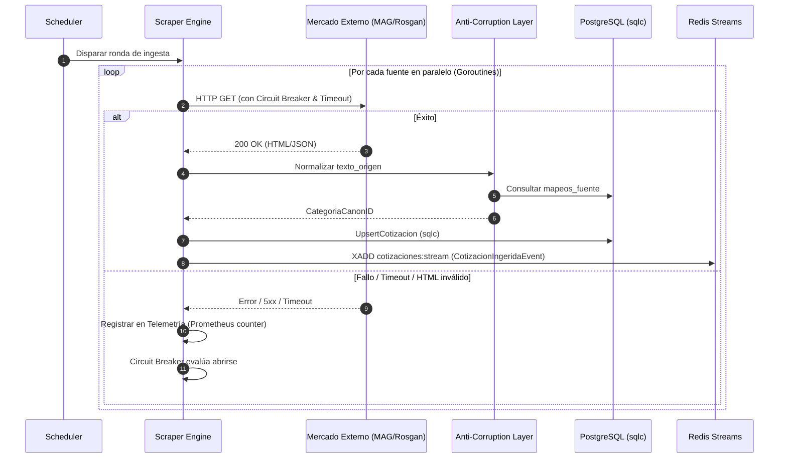
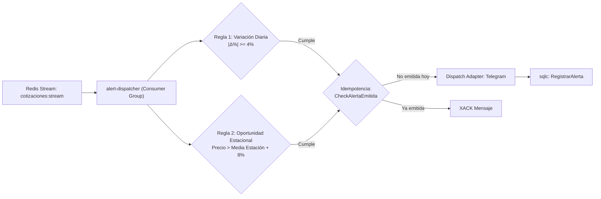

# Arquitectura de Software Profesional: Plataforma Ganadera (Cotizador, Monitor y Analítica)

Este documento define la arquitectura de software de nivel industrial para el sistema de cotizaciones, analítica estacional y liquidación neta ganadera. El diseño abandona los compromisos de un MVP temporal y adopta estándares de **Clean Architecture**, **Domain-Driven Design (DDD)**, diseño basado en **contenedores desacoplados**, persistencia type-safe con **`sqlc`**, resiliencia distribuida y observabilidad completa.

---

## 1. Dominio y Bounded Contexts (DDD)

El sistema se divide en cuatro Bounded Contexts bien delimitados con sus respectivos modelos de dominio y responsabilidades:



---

## 2. Arquitectura de Contenedores y Topología de Red (C4 - Nivel 2)

El sistema se distribuye en contenedores independientes orquestados, separando el tráfico HTTP del procesamiento en background y la ingesta programada.



---

## 3. Estructura de Paquetes Profesional (Clean Architecture Monorepo)

Se implementa el estándar oficial de Go ([Standard Go Project Layout](https://github.com/golang-standards/project-layout)), garantizando aislamiento estricto de dependencias entre capas:

```text
cotizador-ganadero/
├── .github/
│   └── workflows/
│       ├── ci.yml                 # Linting, tests y validación de compilación sqlc
│       └── release.yml            # Build de imágenes Docker multi-stage
├── build/
│   └── package/
│       ├── Dockerfile.api
│       ├── Dockerfile.collector
│       ├── Dockerfile.dispatcher
│       └── Dockerfile.web
├── deployments/
│   ├── docker-compose.yml         # Ambiente local productivo
│   ├── docker-compose.override.yml
│   └── k8s/                       # Manifiestos base para Kubernetes
├── cmd/
│   ├── api-server/                # Entrypoint del servicio de API pública
│   │   └── main.go
│   ├── collector/                 # Entrypoint del worker de extracción y scraping
│   │   └── main.go
│   └── dispatcher/                # Entrypoint del motor de alertas reactivo
│       └── main.go
├── internal/
│   ├── domain/                    # ENTIDADES Y CONTRATOS PUROS (Sin dependencias externas)
│   │   ├── categoria.go
│   │   ├── cotizacion.go
│   │   ├── calculo.go
│   │   ├── alerta.go
│   │   └── events.go
│   ├── db/                        # CÓDIGO GENERADO POR SQLC (Type-Safe persistence)
│   │   ├── db.go
│   │   ├── models.go
│   │   └── queries.sql.go
│   ├── quotation/                 # BOUNDED CONTEXT: Valuaciones y Cotizaciones
│   │   ├── port.go                # Interfaces de Repositorios y Servicios
│   │   ├── service.go             # Casos de uso de negocio (Use Cases)
│   │   └── calculator.go          # Implementación de fórmula financiera de neto
│   ├── collector/                 # BOUNDED CONTEXT: Ingesta y Normalización
│   │   ├── port.go
│   │   ├── normalizer.go          # Anti-Corruption Layer (Mapeo de categorías)
│   │   ├── engine.go              # Orquestador concurrente con Circuit Breaker
│   │   └── sources/               # Estrategias individuales por mercado
│   │       ├── mag.go
│   │       ├── rosgan.go
│   │       ├── tattersall.go
│   │       └── decampo.go
│   ├── analytics/                 # BOUNDED CONTEXT: Analítica y Estacionalidad
│   │   ├── port.go
│   │   └── service.go             # Cálculos de desvíos, percentiles y estacionalidad
│   ├── alert/                     # BOUNDED CONTEXT: Reglas y Notificaciones
│   │   ├── port.go
│   │   ├── engine.go              # Evaluador de reglas (Suba/baja, Oportunidad)
│   │   └── notifier/
│   │       └── telegram.go        # Adaptador del cliente Telegram
│   └── platform/                  # TRANSVERSAL / CROSS-CUTTING CONCERNS
│       ├── config/                # Carga de variables de entorno (Viper/Envconfig)
│       ├── database/              # Inicialización de pool pgxpool
│       ├── eventbus/              # Wrapper de Redis Streams (Producer/Consumer)
│       ├── telemetry/             # Métricas Prometheus y Logger estructurado (Zerolog)
│       └── resilience/            # Circuit Breaker y Retry con Backoff
├── api/
│   ├── openapi/
│   │   └── v1.yaml                # Especificación contractual OpenAPI 3.0
│   └── rest/                      # Handlers HTTP, Middlewares y Enrutamiento (Chi)
│       ├── router.go
│       ├── handlers_cotizacion.go
│       ├── handlers_calculadora.go
│       └── middleware/
│           ├── auth.go
│           ├── logging.go
│           └── ratelimit.go
├── web/                           # Aplicación Web Frontend (SPA Estática)
│   ├── index.html
│   ├── src/
│   │   ├── components/
│   │   ├── services/
│   │   └── app.js
│   └── static/
├── sql/
│   ├── migrations/                # Migraciones versionadas (golang-migrate o goose)
│   │   ├── 000001_init_schema.up.sql
│   │   ├── 000001_init_schema.down.sql
│   │   ├── 000002_add_views.up.sql
│   │   └── 000002_add_views.down.sql
│   ├── queries/
│   │   └── queries.sql            # Consultas fuente para sqlc
│   └── seeds/
│       └── baseline_data.sql
├── sqlc.yaml                      # Configuración de sqlc con pgx/v5
├── Makefile                       # Automatización de tareas de desarrollo
├── go.mod
└── go.sum
```

---

## 4. Persistencia y Mediación Type-Safe con `sqlc`

En un diseño profesional, el acceso a base de datos debe ser:
1. **Fuertemente tipado en tiempo de compilación** (sin reflection ni structs dinámicos).
2. **Versionado mediante migraciones formales** (`golang-migrate`).
3. **Optimizado mediante pool de conexiones** (`jackc/pgx/v5/pgxpool`).

### 4.1. Configuración de `sqlc.yaml`

```yaml
version: "2"
sql:
  - engine: "postgresql"
    schema: "sql/migrations"
    queries: "sql/queries/queries.sql"
    gen:
      go:
        package: "db"
        out: "internal/db"
        sql_package: "pgx/v5"
        emit_json_tags: true
        emit_prepared_queries: true
        emit_interface: true
        emit_empty_slices: true
        overrides:
          - db_type: "numeric"
            go_type: "github.com/shopspring/decimal.Decimal"
```

> [!TIP]
> Se utiliza el override `github.com/shopspring/decimal.Decimal` en lugar de `float64` para los precios y montos. En finanzas y liquidaciones agropecuarias, el redondeo binario de coma flotante introduce errores inaceptables en pesos/dólares.

### 4.2. Migración DDL Profesional (`sql/migrations/000001_init_schema.up.sql`)

```sql
CREATE EXTENSION IF NOT EXISTS "uuid-ossp";

-- Categorías canónicas
CREATE TABLE categorias_canon (
    id SERIAL PRIMARY KEY,
    codigo VARCHAR(30) UNIQUE NOT NULL,
    nombre_visible VARCHAR(80) NOT NULL,
    tipo_destino VARCHAR(20) NOT NULL CHECK (tipo_destino IN ('INVERNADA', 'FAENA', 'CRIA')),
    peso_minimo_kg INT,
    peso_maximo_kg INT,
    activo BOOLEAN NOT NULL DEFAULT true,
    created_at TIMESTAMP WITH TIME ZONE DEFAULT CURRENT_TIMESTAMP,
    updated_at TIMESTAMP WITH TIME ZONE DEFAULT CURRENT_TIMESTAMP
);

-- Mapeos para el Anti-Corruption Layer
CREATE TABLE mapeos_fuente (
    id SERIAL PRIMARY KEY,
    fuente VARCHAR(50) NOT NULL,
    texto_origen VARCHAR(150) NOT NULL,
    categoria_canon_id INT NOT NULL REFERENCES categorias_canon(id) ON DELETE RESTRICT,
    verificado_por_humano BOOLEAN NOT NULL DEFAULT false,
    created_at TIMESTAMP WITH TIME ZONE DEFAULT CURRENT_TIMESTAMP,
    CONSTRAINT unq_fuente_texto UNIQUE(fuente, texto_origen)
);

CREATE INDEX idx_mapeos_fuente_lookup ON mapeos_fuente(fuente, texto_origen);

-- Cotizaciones normalizadas
CREATE TABLE cotizaciones (
    id BIGSERIAL PRIMARY KEY,
    fecha DATE NOT NULL,
    fuente VARCHAR(50) NOT NULL,
    categoria_canon_id INT NOT NULL REFERENCES categorias_canon(id) ON DELETE RESTRICT,
    precio_min NUMERIC(12,2),
    precio_max NUMERIC(12,2),
    precio_promedio NUMERIC(12,2) NOT NULL,
    volumen_cabezas INT DEFAULT 0,
    metadata JSONB DEFAULT '{}'::jsonb,
    created_at TIMESTAMP WITH TIME ZONE DEFAULT CURRENT_TIMESTAMP,
    CONSTRAINT unq_fecha_fuente_cat UNIQUE(fecha, fuente, categoria_canon_id)
);

CREATE INDEX idx_cotizaciones_fecha_cat ON cotizaciones(fecha DESC, categoria_canon_id);
CREATE INDEX idx_cotizaciones_cat_fecha ON cotizaciones(categoria_canon_id, fecha DESC);

-- Registro de auditoría de alertas despachadas
CREATE TABLE alertas_log (
    id UUID PRIMARY KEY DEFAULT uuid_generate_v4(),
    fecha DATE NOT NULL,
    categoria_canon_id INT NOT NULL REFERENCES categorias_canon(id),
    tipo_alerta VARCHAR(40) NOT NULL,
    canal VARCHAR(20) NOT NULL DEFAULT 'TELEGRAM',
    mensaje TEXT NOT NULL,
    metadata JSONB DEFAULT '{}'::jsonb,
    disparado_at TIMESTAMP WITH TIME ZONE DEFAULT CURRENT_TIMESTAMP
);

CREATE INDEX idx_alertas_idempotencia ON alertas_log(fecha, categoria_canon_id, tipo_alerta, canal);
```

### 4.3. Consultas Tipadas (`sql/queries/queries.sql`)

```sql
-- name: UpsertCotizacion :one
INSERT INTO cotizaciones (
    fecha, fuente, categoria_canon_id, precio_min, precio_max, precio_promedio, volumen_cabezas, metadata
) VALUES (
    $1, $2, $3, $4, $5, $6, $7, $8
)
ON CONFLICT (fecha, fuente, categoria_canon_id) 
DO UPDATE SET
    precio_min = EXCLUDED.precio_min,
    precio_max = EXCLUDED.precio_max,
    precio_promedio = EXCLUDED.precio_promedio,
    volumen_cabezas = EXCLUDED.volumen_cabezas,
    metadata = EXCLUDED.metadata,
    created_at = CURRENT_TIMESTAMP
RETURNING *;

-- name: GetUltimasCotizacionesPorCategoria :many
SELECT DISTINCT ON (cot.categoria_canon_id, cot.fuente)
    cot.id,
    cot.fecha,
    cot.fuente,
    cot.categoria_canon_id,
    c.codigo AS categoria_codigo,
    c.nombre_visible AS categoria_nombre,
    c.tipo_destino,
    cot.precio_promedio,
    cot.precio_min,
    cot.precio_max,
    cot.volumen_cabezas
FROM cotizaciones cot
JOIN categorias_canon c ON cot.categoria_canon_id = c.id
WHERE c.activo = true
ORDER BY cot.categoria_canon_id, cot.fuente, cot.fecha DESC;

-- name: GetSerieHistorica :many
SELECT fecha, precio_promedio, precio_min, precio_max, volumen_cabezas, fuente
FROM cotizaciones
WHERE categoria_canon_id = $1 AND fecha >= $2
ORDER BY fecha ASC;

-- name: CheckAlertaEmitida :one
SELECT EXISTS(
    SELECT 1 FROM alertas_log
    WHERE fecha = $1 
      AND categoria_canon_id = $2 
      AND tipo_alerta = $3 
      AND canal = $4
) AS emitida;

-- name: RegistrarAlerta :one
INSERT INTO alertas_log (fecha, categoria_canon_id, tipo_alerta, canal, mensaje, metadata)
VALUES ($1, $2, $3, $4, $5, $6)
RETURNING *;
```

---

## 5. Bounded Context: Ingesta, Resiliencia y Anti-Corruption Layer (ACL)

El servicio `market-collector` se encarga de extraer la información de las 4 fuentes heterogéneas. Para asegurar estabilidad en producción, el proceso no se acopla a las respuestas web directas:



### Tácticas de Resiliencia en Ingesta:
1. **Circuit Breaker:** Si MAG o Rosgan devuelven errores consecutivos (ej. 5 fallos en 2 minutos), el Circuit Breaker se abre para no saturar al proveedor ni bloquear hilos internos.
2. **Rate Limiting & Polite Crawling:** Intervalos aleatorios de jitter y cabeceras personalizadas de `User-Agent`.
3. **Mapeo Asistido de Categorías:** Si aparece una nomenclatura nueva en una fuente, el ACL guarda el registro en `mapeos_fuente` con `categoria_canon_id = NULL` y emite una alerta a los desarrolladores para su homologación, evitando la pérdida de datos o contaminación del modelo canónico.

---

## 6. Bounded Context: Motor de Alertas y Despacho Asíncrono

El servicio `alert-dispatcher` no consulta la base de datos en bucle (polling). Escucha el flujo de eventos de Redis Streams emitidos por el colector.



### Garantía de Idempotencia:
Para evitar enviar múltiples mensajes al productor si un scraper se reejecuta o si el consumidor procesa un reintento, se verifica la tabla `alertas_log` con la clave natural `(fecha, categoria_canon_id, tipo_alerta, canal)`. Solo se dispara a Telegram si dicha combinación no existe.

---

## 7. Despliegue y Orquestación: `docker-compose.yml` Profesional

La solución se orquesta completamente con separación de redes (red interna de datos y red externa de servicios expuestos):

```yaml
version: '3.8'

networks:
  frontend_net:
    driver: bridge
  backend_net:
    driver: bridge
  data_net:
    internal: true # Aislamiento total: base de datos sin salida a internet

volumes:
  pg_data:
  redis_data:

services:
  # -------------------------------------------------------------
  # Persistencia y Mensajería
  # -------------------------------------------------------------
  postgres:
    image: postgres:16-alpine
    container_name: cotizador_postgres
    environment:
      POSTGRES_DB: cotizador_db
      POSTGRES_USER: ${DB_USER:-cotizador_app}
      POSTGRES_PASSWORD: ${DB_PASSWORD:-cotizador_secret_pwd}
    volumes:
      - pg_data:/var/lib/postgresql/data
      - ./sql/migrations:/docker-entrypoint-initdb.d
    networks:
      - data_net
    healthcheck:
      test: ["CMD-SHELL", "pg_isready -U ${DB_USER:-cotizador_app} -d cotizador_db"]
      interval: 5s
      timeout: 5s
      retries: 5
    restart: unless-stopped

  redis:
    image: redis:7-alpine
    container_name: cotizador_redis
    command: ["redis-server", "--appendonly", "yes"]
    volumes:
      - redis_data:/data
    networks:
      - data_net
    healthcheck:
      test: ["CMD", "redis-cli", "ping"]
      interval: 5s
      timeout: 3s
      retries: 5
    restart: unless-stopped

  # -------------------------------------------------------------
  # Aplicaciones Go (Microservicios / Procesos Especializados)
  # -------------------------------------------------------------
  api-server:
    build:
      context: .
      dockerfile: build/package/Dockerfile.api
    container_name: cotizador_api
    environment:
      - PORT=8080
      - DATABASE_URL=postgres://${DB_USER:-cotizador_app}:${DB_PASSWORD:-cotizador_secret_pwd}@postgres:5432/cotizador_db?sslmode=disable
      - REDIS_URL=redis:6379
      - LOG_LEVEL=info
    depends_on:
      postgres:
        condition: service_healthy
      redis:
        condition: service_healthy
    networks:
      - data_net
      - backend_net
    restart: unless-stopped

  market-collector:
    build:
      context: .
      dockerfile: build/package/Dockerfile.collector
    container_name: cotizador_collector
    environment:
      - DATABASE_URL=postgres://${DB_USER:-cotizador_app}:${DB_PASSWORD:-cotizador_secret_pwd}@postgres:5432/cotizador_db?sslmode=disable
      - REDIS_URL=redis:6379
      - SCRAPE_INTERVAL=1h
      - LOG_LEVEL=info
    depends_on:
      postgres:
        condition: service_healthy
      redis:
        condition: service_healthy
    networks:
      - data_net
      - backend_net
    restart: unless-stopped

  alert-dispatcher:
    build:
      context: .
      dockerfile: build/package/Dockerfile.dispatcher
    container_name: cotizador_dispatcher
    environment:
      - DATABASE_URL=postgres://${DB_USER:-cotizador_app}:${DB_PASSWORD:-cotizador_secret_pwd}@postgres:5432/cotizador_db?sslmode=disable
      - REDIS_URL=redis:6379
      - TELEGRAM_BOT_TOKEN=${TELEGRAM_BOT_TOKEN}
      - TELEGRAM_CHAT_ID=${TELEGRAM_CHAT_ID}
      - LOG_LEVEL=info
    depends_on:
      postgres:
        condition: service_healthy
      redis:
        condition: service_healthy
    networks:
      - data_net
      - backend_net
    restart: unless-stopped

  # -------------------------------------------------------------
  # Frontend & API Gateway
  # -------------------------------------------------------------
  web-client:
    build:
      context: .
      dockerfile: build/package/Dockerfile.web
    container_name: cotizador_web
    networks:
      - backend_net
    restart: unless-stopped

  gateway:
    image: nginx:alpine
    container_name: cotizador_gateway
    ports:
      - "80:80"
    volumes:
      - ./deployments/nginx.conf:/etc/nginx/nginx.conf:ro
    depends_on:
      - api-server
      - web-client
    networks:
      - frontend_net
      - backend_net
    restart: unless-stopped
```

---

## 8. Tácticas de Atributos de Calidad de Grado Industrial

| Atributo de Calidad | Táctica Específica | Implementación en la Solución |
|---|---|---|
| **Disponibilidad (Availability)** | Aislamiento de Fallas (Fault Containment) | El fallo o bloqueo del proceso de scraping (`market-collector`) no degrada la API de cotizaciones (`api-server`), la cual sigue sirviendo precios cacheados desde Redis/PostgreSQL. |
| **Integridad de Datos** | Aritmética Exacta (Precision Handling) | Reemplazo de tipos nativos `float64` por `decimal.Decimal` en `sqlc` y Go, evitando inconsistencias contables en liquidaciones. |
| **Rendimiento (Performance)** | Cache Asíncrono de Dos Niveles | Lectura de cotizaciones frecuentes atendidas por Redis en $<2\text{ms}$; consultas complejas de estacionalidad respaldadas por vistas SQL indexadas. |
| **Mantenibilidad (Maintainability)** | Arquitectura Hexagonal & Anti-Corruption Layer | Los cambios de diseño en los portales de MAG, Rosgan o Tattersall quedan confinados en sus respectivos archivos de `sources/` y en la tabla `mapeos_fuente`, sin tocar la lógica de negocio ni la base de datos central. |
| **Observabilidad (Observability)** | Telemetría Abierta | Registro de logs estructurados en JSON (`zerolog`) con correlación `request_id` y métricas estándar expuestas en `/metrics` para Prometheus. |
| **Seguridad (Security)** | Redes Segregadas (Defense in Depth) | La base de datos PostgreSQL corre en una red `data_net` estrictamente interna sin mapeo de puertos hacia la máquina host ni exposición a internet. |

---

## 9. Contrato de API (OpenAPI 3.0 Summary)

La API expone los servicios a través del Gateway en `/api/v1`:

*   `GET /api/v1/cotizaciones/resumen`: Retorna el tablero consolidado por categoría canónica, última variación y dispersion de precios entre fuentes.
*   `GET /api/v1/cotizaciones/historico/{categoria_id}?desde={fecha}`: Serie temporal histórica para análisis gráfico.
*   `GET /api/v1/analitica/estacionalidad/{categoria_id}`: Estadísticas agrupadas por estaciones climáticas (Verano, Otoño, Invierno, Primavera) y percentiles históricos.
*   `POST /api/v1/calculadora/neto`: Ejecuta la liquidación parametrizada con desbaste, flete por km, comisiones y descuento financiero.
*   `GET /api/v1/healthz`: Endpoint de sondeo de salud para orquestadores (Kubernetes/Docker healthchecks).
